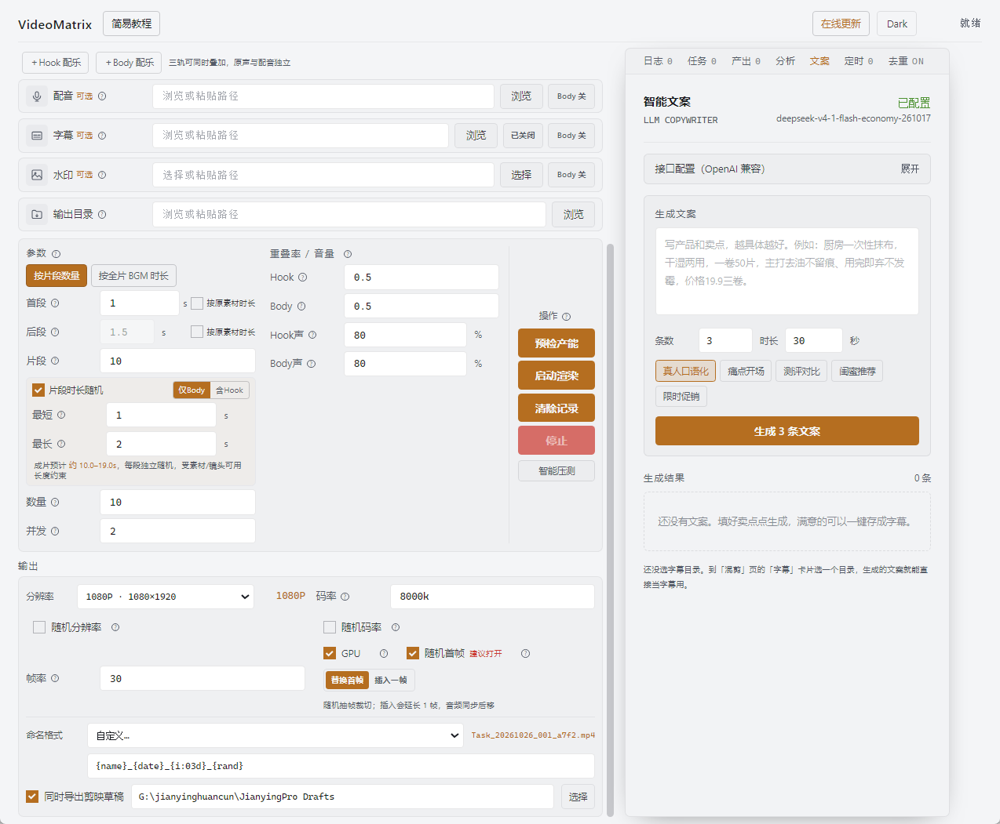
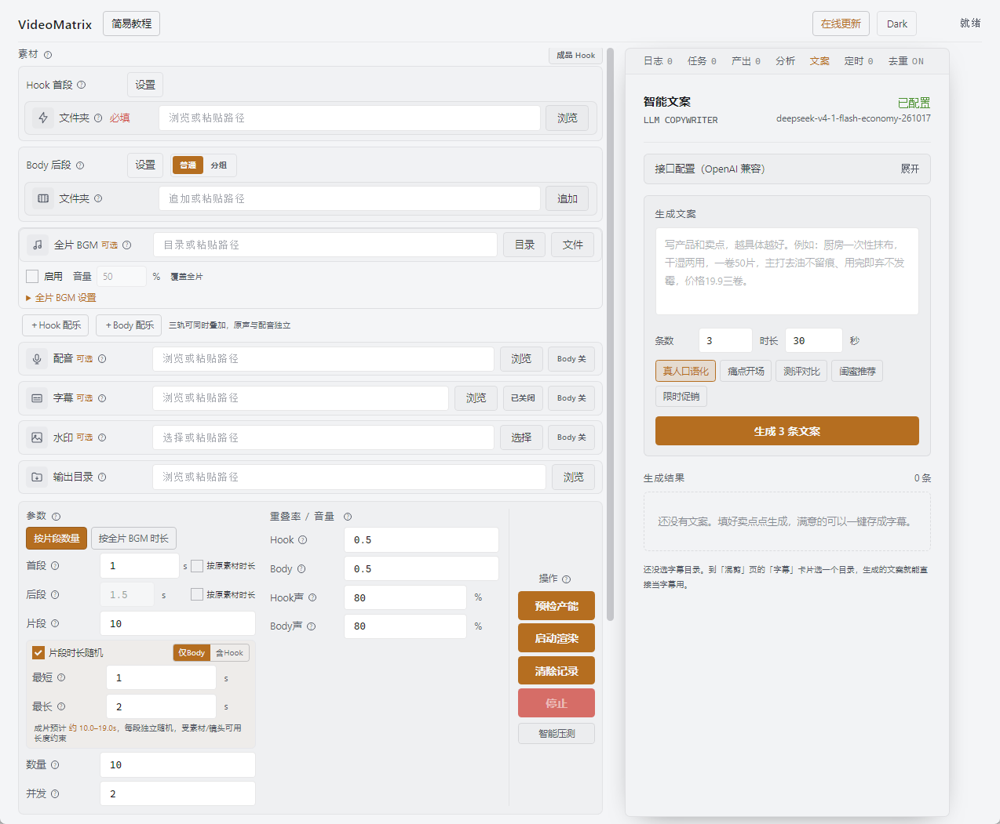

# VideoMatrix


短视频矩阵自动化混剪工具。这个软件主要面向需要大量信息流素材、抖音千川素材、服装/电商花絮素材、Hook 测试素材的人，用来把原始片段自动裁剪、乱序拼接、加 BGM、加配音、加字幕、加水印，并批量导出多条视频。

它不是通用剪辑软件，不提供手动时间线或复杂调色、美化。它更像一个“素材矩阵生成器”：把素材批量重组，并提供简单的居中放大裁切，解决人工纯混剪效率低的问题。




> 本项目基于 [VideoMatrix](https://github.com/w2968066/VideoMatrix--) 二次开发，遵循 MIT 协议。在原版基础上加入了素材智能分析、片段时长随机、剪映草稿导出等能力，并改为独立发布自有版本。

> **本地新增功能**
> - **定时混剪**：右侧「定时」标签可设单次 / 每天 / 每周 / 间隔自动开跑；设了任务后关窗口只收进托盘，后台继续等点。详见 [定时混剪说明.md](定时混剪说明.md)。
> - **剪映草稿导出**：每条成片同时生成一份剪映草稿，可直接打开精修（片段 / 音量 / BGM / 配音 / 字幕都还原）。
> - **分辨率下拉**：720P / 1080P / 2K / 4K，按竖屏 9:16、竖版 3:4、横屏 16:9 分组，也能自定义宽高。
> - **自定义命名**：文件名用下拉预设控制（简洁 / 带日期 / 带日期时间 / 带随机串），支持 `{name}` `{i:03d}` `{date}` `{time}` `{rand}` 等占位符，也可完全自定义。
> - **智能文案**：右侧「文案」标签接 OpenAI 兼容接口生成口播文案，一键存成 SRT 当字幕用。
> - **素材智能分析**：右侧「分析」标签先切镜头、做画面体检、标出高光片段，再按分数自动选片；不配任何模型也能用。
> - **片段时长随机**：参数区勾选「片段时长随机」后，每段在「最短–最长」之间独立随机截取，可选仅 Body 或含 Hook，成片总时长随之浮动。
> - **字幕自动断句**：导入 SRT 时按语义切成短句、按字数重排时间轴，长句不再折成三四行；可选 AI 语义断句，详见 [字幕断句与排版说明.md](字幕断句与排版说明.md)。
>
> 草稿 / 命名 / 文案详见 [剪映草稿与文案说明.md](剪映草稿与文案说明.md)，画面分析详见 [素材智能分析说明.md](素材智能分析说明.md)。

## 下载

到 **[Releases](https://github.com/5100369/JYproject/releases/latest)** 下载最新版，双击安装即可，不需要装 Python 或 FFmpeg。

| 平台 | 安装包 | 说明 |
|---|---|---|
| Windows 10 / 11 x64 | `VideoMatrix.Setup.x.y.z.exe` | 双击安装，可选安装目录 |
| macOS Apple Silicon | `VideoMatrix.Setup.x.y.z-mac.dmg` | 拖入「应用程序」；仅支持 M 系列芯片 |

> **macOS 提示**：安装包未做 Apple 开发者签名与公证，首次打开若提示「无法验证开发者」，右键点图标 → 打开 即可。
>
> **Windows 提示**：未购买代码签名证书，SmartScreen 可能提示「未知发布者」，点「更多信息 → 仍要运行」。

装好之后软件会在启动时自动检查更新，也可以点顶部「在线更新」手动检查。

## v1.0.0 说明

本版本包含 VideoMatrix 的完整混剪能力，并新增：

- **素材智能分析**：切镜头、画面体检、OCR/语义打分、按分数自动选片（右侧「分析」标签）
- **片段时长随机**：每段在「最短–最长」之间独立随机截取（参数区勾选）
- **剪映草稿导出**：每条成片同时生成一份可精修的剪映草稿
- **定时混剪**：单次 / 每天 / 每周 / 间隔自动开跑
- **智能文案**：接 OpenAI 兼容接口生成口播文案，可存成 SRT 直接当字幕

历史版本的功能明细见 [CHANGELOG.md](CHANGELOG.md)。

## 适合谁

适合：

- 需要大量短视频素材做信息流投放的人。
- 需要批量测试不同 Hook、不同卖点排序的人。
- 有很多服装、产品、模特花絮、口播、细节镜头素材的人。
- 希望把 1 条素材拆成多条“结构不同”的素材用于测试的人。

不适合：

- 只想做单条精剪视频的人。
- 需要复杂转场、精细包装、调色、特效设计的人。
- 没有大量乱序拼接需求的人。

## 它能做什么


主要能力：

- 批量裁剪视频片段。
- Hook 首段和 Body 后段分开管理。
- 自动乱序拼接，生成多条不同组合的视频。
- 支持同文件夹纯混剪。
- 支持 Hook 和 Body 分文件夹组合。
- 支持总文件夹下多子文件夹批量处理。
- 支持 BGM、配音、字幕、水印，包括 GIF 水印。
- 支持成品 Hook 模式，可让 BGM、配音、字幕、水印只从 Body 段开始生效。
- 支持 Hook 与 Body 分别设置原声音量，也支持直接使用视频文件的声音作为 BGM。
- 支持 GPU 加速。实际速度取决于素材、分辨率、显卡和并发设置。
- 支持预检产能和智能压测。
- 支持历史记录，避免重复使用已经用过的片段。
- 支持主输出随机分辨率、随机码率；两个开关独立于去重变换。
- 支持可选成品变换层：微裁切、可选色彩变化/随机镜像/B 画面混合；保持主片音轨、时间线、分辨率和帧率。
- 支持 Codex 等 Agent 打开软件、识别并填写 Hook / Body / BGM 等路径和混剪参数。

### 随机输出参数（v2.6.0）

在左侧“输出”中分别勾选“随机分辨率”“随机码率”，开启后填写上下限。默认均关闭，关闭后仍使用原固定参数；开启随机分辨率时，原分辨率用于确定比例。

- **随机分辨率**：默认短边 1080–1440 px，保持当前宽高比，宽高均为偶数；每条视频抽一次，Hook 与所有 Body 使用同一尺寸。9:16 下有 21 个合法尺寸，含 1080×1920 和 1440×2560，随机允许重复。
- 自定义随机范围限制最大长边 8192 px、总像素 35,389,440；极端比例或超过预算会在生成前提示，不静默缩小范围。此上限不是显卡支持保证。
- **随机码率**：默认 8000–14000 kbps，每条视频独立抽取一个整数目标码率；实际文件平均码率受画面与编码器影响，不保证精确等于目标值。
- 字幕保持相对位置和字号；随机分辨率时水印随画面等比缩放。去重变换、随机首帧和失败重试沿用本条抽到的尺寸与码率，不重新抽取。
- 两项直接用于混剪已有缩放与编码，不额外增加一道转码。高分辨率仍会增加运算量，较高码率可能增大文件；GPU 探测使用范围上限，压测各并发使用相同随机参数序列。实际抽到的参数写入日志。

### 随机首帧与成片保存（v2.6.0）

- 随机首帧合并到主混剪编码：从本条选中的 Hook / Body 裁切区间抽一帧并缩放裁切，不再对整片二次转码。封面不包含软件后加的字幕、水印或去重效果，以批量效率优先。
- 替换模式保持时长和音频不变；插入模式增加一帧静音画面，原音画同步后移。关闭开关不抽帧、不增加编码。
- 编码前独占预留唯一正式文件名，直接输出 MP4，完成后不再改名、覆盖或搬运；不再在输出目录留下逐条 `.vm-*` 文件夹。同名任务不会覆盖已有结果。
- 仅编码成功才加入产出列表；失败/停止时清理本条未完成文件，已编码成功的文件不会因稍后停止而丢失。取帧或封面编码失败时有限回退基础混剪。
- 先前 6 秒合成短片的性能结果未覆盖 4K 高帧率 Body 与长 Hook 场景，不再作为整体性能结论。验证口径与复现记录见 [验证记录](docs/fused-cover-validation.md)。
- 原声独立按音频流读取，避免长 Hook 拼接高分辨率 Body 时为取音频而提前缓存大量解码画面。保留原音轨、输出规格与时间线，不额外转码视频。
- 抽帧禁用交互输入，所有渲染子进程隔离软件保活管道，修复 Windows 下封面已写完但进程不退出、最终等待 30 秒超时的问题。不增加重试或二次编码。

### 成品变换层

“去重变换”位于右侧独立页签，默认关闭。v2.6.0 的 V2 采用独立配方模块，与混剪共用一次编码，不修改 Hook、Body 等源素材；默认不进行扫描、候选筛选或报告生成。历史 v2.1.0 公告描述的是旧实现。

- 开启后默认仅微裁切：“轻度 / 标准 / 增强”分别最多额外裁去每方向两侧合计 0.5% / 1% / 2%，叠加在原有画幅适配之后。界面会显示档位说明。
- 轻微色彩变化、随机镜像均单独勾选；镜像会翻转源画面的文字和 Logo。软件新加的字幕、水印在变换后叠加，不受该镜像影响。
- B 画面混合默认关闭，需单独选一个视频。可设置 1%–15% 不透明度，短素材可循环、定格末帧，或跳过混合并提示。仅混合画面，不使用 B 视频声音；该选项会增加解码和滤镜耗时。
- 每个输出及其内部片段使用独立随机参数。
- 不再启用旧版相邻帧混合、噪声、旋转、锐化或音频变调。关闭总开关保留选择，下次开启无需重配。
- 变换渲染失败时，使用同一批片段和音频回退重试一次基础混剪；成功后保留成片并提示，停止任务不会触发回退。
- 不承诺平台“首发”、去重或 AI 识别结果。实现边界、独立接口与验证说明见 [V2 设计说明](docs/dedup-layer-v2.md)。

## Agent 工作流

仓库包含独立的 `agent_adapter` 适配层和 VideoMatrix Skill。它们只调用现有桌面程序与后端，不另写混剪核心。

默认采用半自动模式：Agent 只打开 VideoMatrix，并把用户明确提供的素材路径和参数合并到软件上次设置；不会自动点击预检或开始渲染。只有用户明确要求“预检”或“直接开始”时，Agent 才会执行相应动作。

支持自然语言换算视频结构。例如：

```text
这个目录是 Hook，那个目录是 Body，整条 12 秒，首段 3 秒，使用默认配置打开软件。
```

适配层会填写 Hook `3` 秒、Body `1.8` 秒、总片段数 `6`，并使用竖屏 2K、`8000k`、`24fps`；用户检查后再手动开始。省略“使用默认配置”时，软件原有的时长、音量、分辨率和并发等设置保持不变。

一键接入本机 Codex：

```powershell
PowerShell -ExecutionPolicy Bypass -File agent_adapter/install_codex.ps1
```

详细命令与 MCP 工具见 [`agent_adapter/README.md`](agent_adapter/README.md)。

## 使用前预处理

软件只负责裁剪、拼接、加 BGM、加配音、加字幕、加水印。原素材建议先在剪映或其他剪辑软件里预处理。

推荐流程：

1. 设置草稿分辨率和帧率，例如 `1080*1920`、`30` 帧。
2. 把所有素材片段拖进时间线。
3. 完成调色、画面大小、构图、基础包装等处理。
4. 全选时间线片段。
5. 右键导出所有片段。
6. 注意不是导出整条时间线，而是导出每个片段。

这样得到的素材更适合交给 VideoMatrix 批量混剪。

## 核心概念

### Hook

Hook 是视频开头片段。一般短视频前 2 到 3 秒不一样，对很多投放场景来说就已经是不同的视频结构。

Hook 值可以理解为相邻切片之间允许重叠的比例：


- Hook 值越大，相邻片段重叠越多。
- Hook 值越大，可切出的独立片段数量越少。
- Hook 设置为 `1` 时，接近重复使用模式，适合固定强 Hook 去搭配不同后段。

### Body

Body 是后段素材。它负责承接 Hook 后面的内容，可以是卖点、产品细节、花絮、场景、模特动作、口播辅助画面等。

Body 会在单条成片内部尽量避免重复画面，但跨视频可以复用，适合大量组合。

### 成品 Hook

如果 Hook 文件本身已经带有 BGM、配音、字幕或水印，可以打开“成品 Hook”模式。开启后，Hook 段保留原始声音和画面，BGM、配音、字幕、水印从 Body 段开始生效，避免重复叠加。

这类 Hook 文件应当提前按最终输出的分辨率和帧率导出。首段时长设置为素材实际视频轨时长或更短，软件会保留尾部安全边距并允许刚好够长的整段素材使用。

## 用法 1：纯混剪

用于解决素材量不足的问题。

设置方式：

- Hook 和 Body 共用同一个文件夹。
- 把原来的多个片段自动调换顺序。
- 一条素材可以扩展出多条不同组合的视频。

适合场景：

- 服装类目拍了很多段模特花絮。
- 产品细节、场景素材、空镜素材比较多。
- 想快速生成几十条或上百条素材。

建议：

- Hook 重叠率可以从 `0` 或 `0.1` 开始。
- Body 重叠率不要太高，`0.3` 通常已经偏高。
- 重叠率越高，重复利用的片段越多，素材差异会变小。

多款处理：

- 每个款式单独放一个子文件夹。
- 再把这些子文件夹放到一个总文件夹。
- 软件选择总文件夹后会自动处理所有子文件夹。
- 导出结果也会按 Hook 子文件夹分类。

## 用法 2：不同 Hook 搭配后段

用于解决不同开头素材的拼接工作。

设置方式：

- Hook 和 Body 使用不同文件夹。
- Hook 放你要测试的开头。
- Body 放后段素材或卖点素材。
- Hook 重叠率设置为 `1`，让强 Hook 可以重复搭配不同后段。

适合场景：

- 你有多个不同开头，需要快速产出测试素材。
- 后段只是卖点排序或产品画面，变化要求没那么高。
- 一个 Hook 需要生成 10 条、20 条不同后段组合，用来提高测试机会。

目的：

- 给强 Hook 配足够的素材。
- 避免只有一条素材导致 Hook 再好也不一定排得上流量。
- 快速测试不同后段承接方式。

## 用法 3：水印、字幕、配音

水印、字幕、配音都有独立路径。

可结合上面两种用法使用：

- 加品牌水印。
- 加 GIF 动态水印。
- 加字幕文件。
- 加讲解配音。
- 加 BGM 或调整原声音量。

## 路径说明

- Hook、Body、BGM、配音、字幕、水印、输出目录都有独立路径。
- Hook 和 Body 支持总文件夹下子文件夹分类。
- 多款素材建议按子文件夹整理。
- 导出会按 Hook 子文件夹分类。
- 输出目录不是必填，不填会使用默认输出逻辑。

## 设置说明

### 历史记录

软件会记住哪些 Hook 片段用过。没剪完下次继续时，它会尽量避开已经用过的片段。

不要随便点“清除记录”。清除后，之前用过的片段会重新进入可用池。

### 预检产能

点击预检产能后，软件会按当前参数估算最多能剪出多少条。

如果你设置的生成数量超过可用产能，开始渲染时会按预检产能自动降低，避免强行生成失败。

### 智能压测

智能压测固定同一批最多 8 条完整样本，使用当前素材、输出盘及开启的后处理测试 1–4 路并发。预热后进行初测，并复测最多两个最快稳定档位，按整批完成时间给出建议；差距在 5% 以内优先较低并发。

完整压测最多执行 49 次渲染，耗时取决于成片长度和配置。右侧任务页显示真实进度并可单独停止；压测与生产不能同时运行，测试不会消耗正式素材使用记录。样本不足或结果不稳定时保留当前并发设置。

日志中的“单条实际平均耗时”与“整批总耗时 / 每分钟产量”是不同指标：较高并发可能提高整批产量，却让单条视频等待更久。建议并发不是固定保证，同时运行其他软件或更换素材、输出参数后，结果可能变化。

### GPU

开启 GPU 后会探测可用硬件编码器：Windows 支持 NVIDIA / Intel / AMD，macOS 使用 VideoToolbox。多个任务共用编码并发预算；暂时资源故障会有限重试和降低并发，硬件不可用时在日志说明原因并回退 CPU。解码及软件滤镜仍可能使用 CPU，是否明显加速取决于硬件、素材规格、分辨率和并发数。

例如 12 秒视频素材在合适配置下可以做到几秒生成一条，但这不是固定承诺。

## 在线更新

顶部新增“在线更新”入口：正式版启动检查、空闲下载、加速源回退、暂停/断点续传，签名清单与安装包哈希校验通过后才允许确认安装。混剪、压测及停止清理期间不安装；已有任务续跑不能跨重启恢复。

Windows 打开安装向导，Mac 下载 DMG 后手动安装；开发版只检查和下载，不执行安装，另提供不依赖网络的安全更新演练。默认三个加速源与 GitHub 原站，可检测响应时间、排序和配置国内副本。首个带更新器的正式版仍需手动安装一次。详细使用、签名密钥配置及发版步骤见 [在线更新说明](docs/online-updates.md)。

## 本地运行

开发环境运行：

```powershell
cd backend
python app.py

cd ../frontend
npm install
npm run dev
```

## 云端构建

仓库包含 Windows 和 macOS 构建 workflow：

```text
.github/workflows/build-windows.yml
.github/workflows/build-mac.yml
```

可以在 GitHub Actions 页面手动运行，并指定 Release tag。构建完成后会自动上传安装包到对应 Release。

## 本地运行数据

程序可能生成以下配置、缓存或历史文件：

```text
config.json
usage_history.json
media_cache.json
ffmpeg_error_log.txt
```

这些属于本地运行状态，不建议提交到仓库。

## 许可

本项目源代码采用 MIT License。FFmpeg / FFprobe 相关二进制组件遵循其各自许可协议，二次分发时请遵守 FFmpeg 项目的许可要求。
